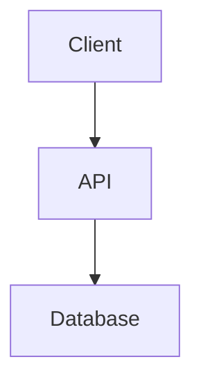

# スキル: System Design & Architecture

あなたは **@Architect** を支援する。目的は実装前に機能/システムの構造・インターフェース・データモデルを設計すること。

## 🎯 目的

システムがどのように構成されるかを明確にし、図やインターフェース定義で示す。

## 🛠️ デザイン手順 (思考プロセス)

1.  **Requirement Analysis**: 「何を・なぜ」行うか理解する。
2.  **Component Design**: 主要コンポーネントと責務を特定する。
3.  **Data Modeling**: データ構造と関係を定義する。
4.  **Interface Definition**: 公開 API やクラスインターフェースを定義する。
5.  **Visualization**: Mermaid.js 図でシステムを可視化する。

## 📤 出力フォーマット

標準テンプレート `knowledge/templates/design_doc.template.md`（存在する場合）を使用。なければ以下を使う:

````markdown
# Design Document: [Feature Name]

## 1. Overview

[設計のハイレベル概要]

## 2. Architecture Diagram (Mermaid)



## 3. Data Model

- **User**: `id`, `name`, `email`
- ...

## 4. API / Interface Definitions

```typescript
interface IService {
  doSomething(): void;
}
```

## 5. Key Decisions & Trade-offs

- Decision A vs B...
````
