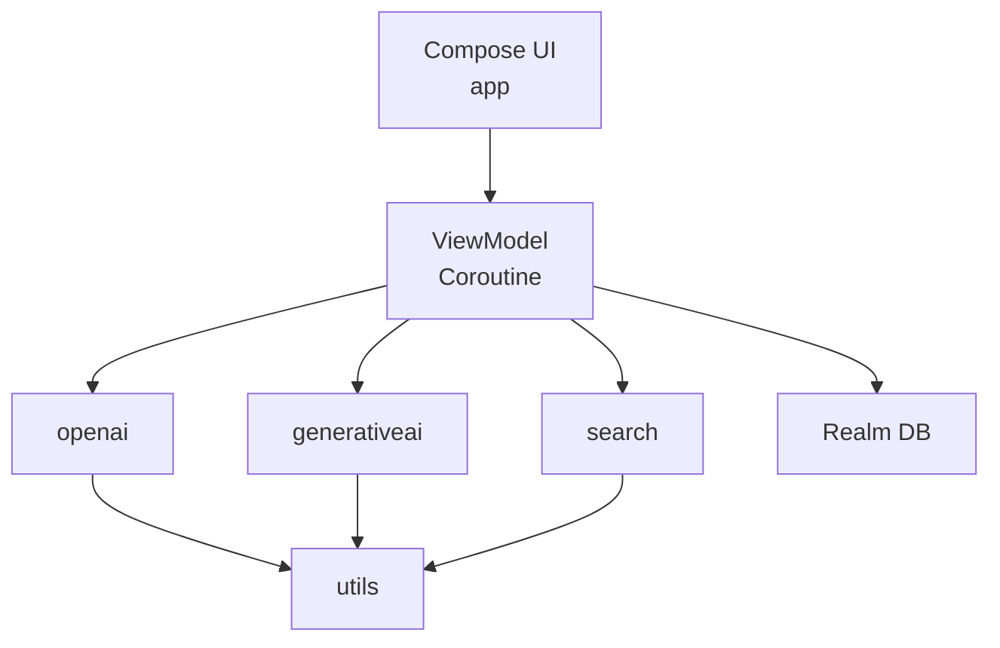
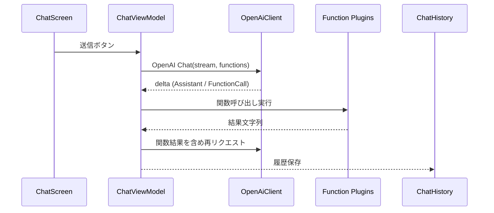

<!-- This document is generated and updated by .github/prompts/doc-sync.prompt.md -->

# アーキテクチャ概要

## システム概要

Windows 11 上で動作する Kotlin/Compose Desktop アプリで、OpenAI のチャット・関数呼び出し・画像生成と Google PaLM(Dicsuss)・Custom Search を単一 UI から操作します。エージェント風のチャット履歴管理とログ取得、外部プラグイン関数読み込みを備え、履歴は Realm DB に保存されます。

## 主なコンポーネント

- アプリシェル: Compose Desktop ウィンドウとタブ UI ([app/src/jvmMain/kotlin/net/longbowxxx/playground/Main.kt](app/src/jvmMain/kotlin/net/longbowxxx/playground/Main.kt#L17))
- プレゼンテーション: タブ切替・スプラッシュ含む画面構成 ([app/src/jvmMain/kotlin/net/longbowxxx/playground/ui/PlaygroundScreen.kt](app/src/jvmMain/kotlin/net/longbowxxx/playground/ui/PlaygroundScreen.kt#L21))
- ビューモデル: チャット/ディスカス/画像/音声認識の状態管理と非同期処理 ([app/src/jvmMain/kotlin/net/longbowxxx/playground/viewmodel](app/src/jvmMain/kotlin/net/longbowxxx/playground/viewmodel))
- データアクセス: OpenAI クライアント、PaLM クライアント、Google Custom Search クライアント ([openai](openai/src/main/kotlin/net/longbowxxx/openai), [generativeai](generativeai/src/main/kotlin/net/longbowxxx/generativeai), [search](search/src/main/kotlin/net/longbowxxx/search))
- 永続化: チャット/ディスカス履歴を Realm DB に保存 ([app/src/jvmMain/kotlin/net/longbowxxx/playground/history](app/src/jvmMain/kotlin/net/longbowxxx/playground/history))
- プラグイン/関数: OpenAI 関数呼び出し用プラグインをバンドルし、外部ディレクトリから読み込み ([app/src/jvmMain/kotlin/net/longbowxxx/playground/function](app/src/jvmMain/kotlin/net/longbowxxx/playground/function))
- ユーティリティ: ロギング・URL/UUID 拡張 ([utils/src/main/kotlin/net/longbowxxx/utils](utils/src/main/kotlin/net/longbowxxx/utils))

## アーキテクチャ図

### チャット + 関数呼び出しフロー

## 設計上の意図

- デスクトップ単体で完結させるため Compose Desktop を採用し、API キーの入力・履歴・ログをローカルに保持。
- 外部サービスごとにモジュール分割 (openai / generativeai / search / utils) し、依存を明確化。
- Realm を単一スレッドで扱う抽象クラス `RealmBase` で I/O を一元化し、安全な履歴保存を実現。
- 関数プラグインをディレクトリスキャンで読み込み、拡張可能な関数呼び出しをサポート。
