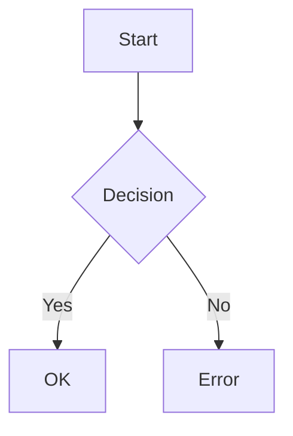

<!-- This document is generated by @Architect -->

# 仕様書: {{TITLE}}

<metadata>

| Metadata                | Value                        |
| :---------------------- | :--------------------------- |
| **Status**              | Draft / In Review / Approved |
| **Source Requirements** | [Link to Requirements]       |

</metadata>

<overview>

## 1. 概要

### 背景

[なぜこの変更が必要か / どんな課題を解決するか]

### 目的

[この機能・変更の具体的な目標]
</overview>

<requirements>

## 2. 要件

### ユーザーストーリー

- As a **[Role]**, I want to **[Action]**, so that **[Benefit]**.

### 受け入れ条件 (Gherkin)

<!-- 振る舞い仕様は明示的な Gherkin 構文で記述 -->
<gherkin>

```gherkin
Feature: [Feature Name]

Scenario: [Scenario Name]
Given [Precondition]
When [Action]
Then [Result]
```

</gherkin>
</requirements>

<technical_design>

## 3. 技術設計

### アーキテクチャ / フロー

<!-- 複雑なロジックは Mermaid で図示 -->

<mermaid_diagram>



</mermaid_diagram>

### ロジック仕様

<logic_details>
[複雑な場合は疑似コードや追加の Gherkin。複雑なら Rule を使用。]
</logic_details>

### データモデル

<data_definitions>
[インターフェース定義・スキーマ変更]
interface Example {
id: string;
}
</data_definitions>

### API 変更

<api_definitions>
[新規 / 変更するエンドポイント]
</api_definitions>

</technical_design>

<verification_plan>

## 4. 検証計画

### 自動テスト

[実装すべきテスト。可能なら上記 Gherkin を参照。]

### 手動確認

[手動テスト手順]
</verification_plan>
